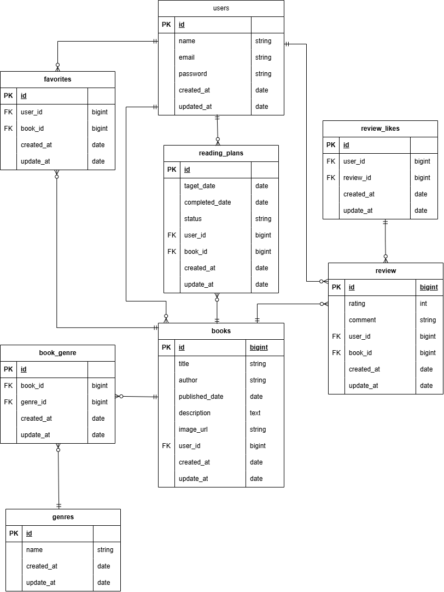

## アプリケーション名
書籍レビューアプリ

## 主な機能
- **会員登録・ログイン・ログアウト**
- **書籍一覧表示（ソート、検索機能）**
- **書籍登録（ISBN検索で自動入力）・編集・削除**
- **ランキング機能**
- **お気に入り登録**
- **ジャンル登録・編集・削除**
- **マイレポート**
- **読書計画一覧表示**
- **読書計画登録・編集・削除**
- **リマインダー通知**

## 環境構築
1. git clone git@github.com:aoimita0619-prog/bookshelf-app.git
2. cd bookshelf-app
3. Docker Desktopアプリを立ち上げる
4. docker run --rm \
    -u "$(id -u):$(id -g)" \
    -v "$(pwd):/var/www/html" \
    -w /var/www/html \
    laravelsail/php82-composer:latest \
    composer install
5. cp .env.example .env
6. ./vendor/bin/sail up -d
7. ./vendor/bin/sail artisan key:generate
8. ./vendor/bin/sail artisan migrate --seed
9. Google Cloudにおいて、新規プロジェクトでBooksAPIを追加し、APIキーを取得する。APIキーをGOOGLE_BOOKS_API_KEY=の後ろに入力

## 実行環境
- **PHP 8.5.3**
- **laravel 10.50.3**
- **MySQL8.4**

## URL
- **書籍一覧　http://localhost/books**
- **ログイン画面 http://localhost/login**
- **会員登録画面 http://localhost/register**
- **API書籍一覧画面 http://localhost/v1/books**
- **phpMyAdimin http://localhost:8080**

## ER図

## テーブル設計
- **usersテーブル　アカウントを記録するテーブル**
- **booksテーブル　書籍を記録するテーブル**
- **genresテーブル　ジャンルを記録するテーブル**
- **reviewsテーブル　書籍のレビューを記録するテーブル**
- **favoritesテーブル　お気に入り機能のテーブル**
- **review_likesテーブル　レビューのいいね機能のテーブル**
- **reading_plansテーブル　読書計画を記録するテーブル**
- **book_genreテーブル　booksテーブルとgenresテーブルの中間テーブル**
- **notificationsテーブル　リマインダー通知のテーブル**

## ログインアカウント

- **name: 山田太郎, email: yamada@example.com, password: password**
- **name: 鈴木花子, email: suzuki@example.com, password: password**
- **name: 田中一郎, email: tanaka@example.com, password: password**
- **name: 佐藤美咲, email: sato@example.com, password: password**
- **name: 高橋健太, email: takahashi@example.com, password: password**

## テスト

###　単体テスト
- **モデル**

### 機能テスト
- **画面アクセス**
- **書籍表示・登録・編集・削除**
- **レビュー**
- **ジャンル**
- **お気に入り機能**
- **いいね機能**
- **ランキング**
- **認証機能**
- **公開APIの表示・登録・編集・削除・ソート・絞り込み・認証**
- **ISBN検索**
- **マイ読書レポート**
- **読書計画**
- **リマインダー通知**
- **読書計画自動失効**

